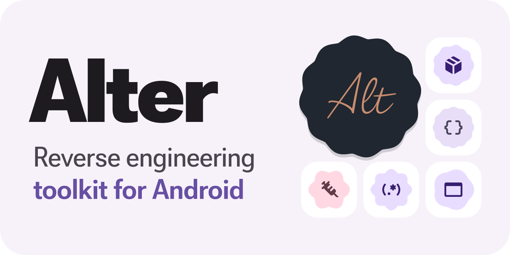
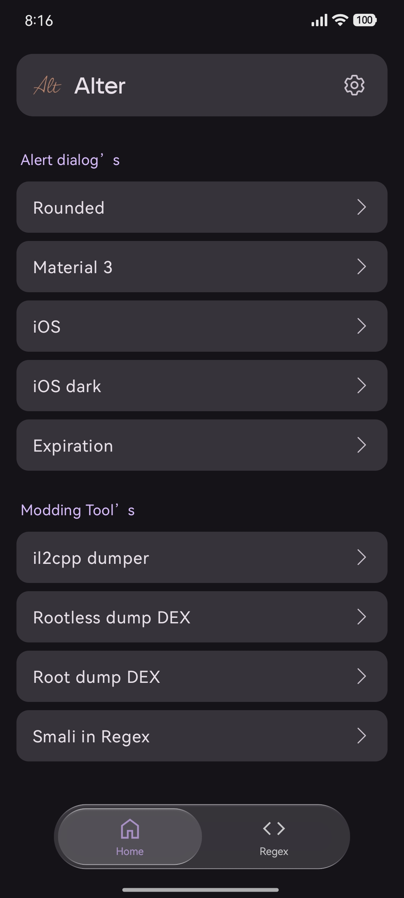
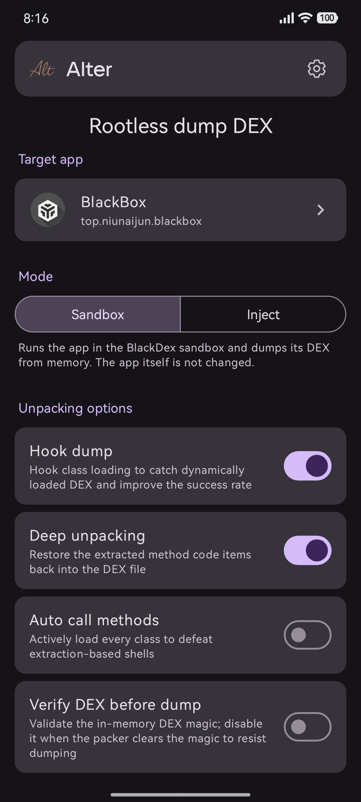
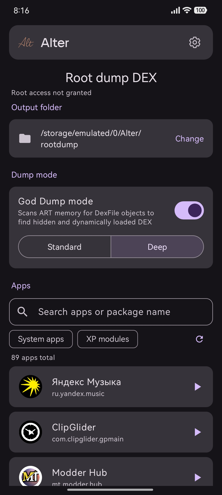
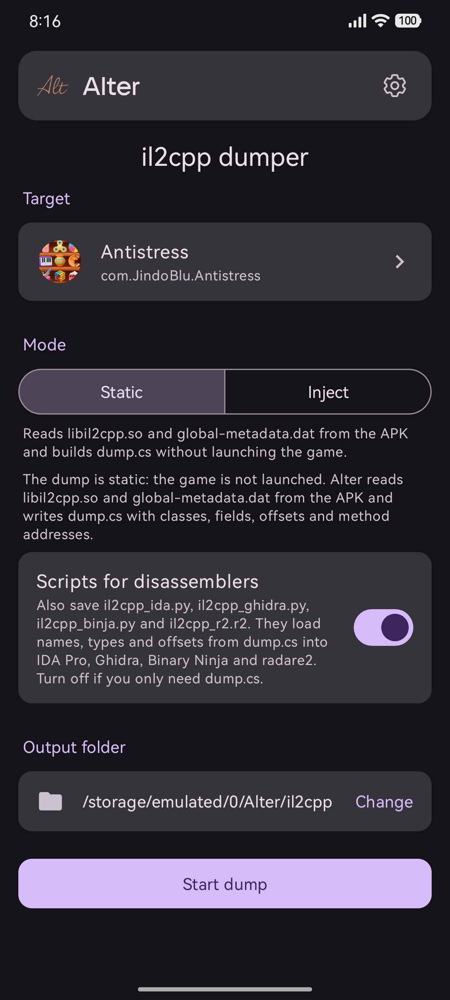
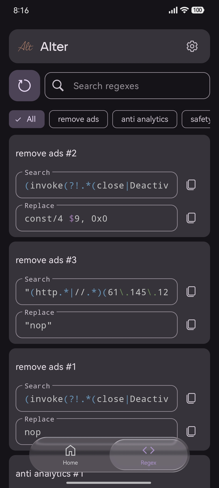
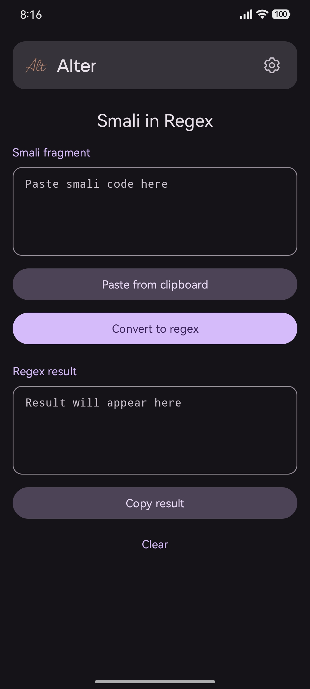

**English** · [Русский](README.ru.md)

  <a href="https://github.com/vanth34/Alter/releases/latest"><picture><source media="(prefers-color-scheme: dark)" srcset="docs/assets/readme/banner-en-dark.svg"></picture></a>

**A modern toolkit for APK modification and reverse engineering**

Alter brings your APK tools together in a single app. It is built for modders and reverse engineers who need a convenient way to analyze, patch and modify apps. Everything you need in one place, without extra tools or complicated setup.

<picture><source media="(prefers-color-scheme: dark)" srcset="docs/assets/readme/badges/android-dark.svg"></picture> <picture><source media="(prefers-color-scheme: dark)" srcset="docs/assets/readme/badges/root-dark.svg"></picture> <picture><source media="(prefers-color-scheme: dark)" srcset="docs/assets/readme/badges/java-dark.svg"></picture> <a href="LICENSE"><picture><source media="(prefers-color-scheme: dark)" srcset="docs/assets/readme/badges/license-dark.svg"></picture></a>

 

<a href="https://github.com/vanth34/Alter/releases/latest/download/app-release.apk"><picture><source media="(prefers-color-scheme: dark)" srcset="docs/assets/readme/buttons/download-en-dark.svg"></picture></a>&nbsp;&nbsp;<a href="https://t.me/AlterProject"><picture><source media="(prefers-color-scheme: dark)" srcset="docs/assets/readme/buttons/telegram-en-dark.svg"></picture></a>

  
  
  
  
  
  

---

## <picture><source media="(prefers-color-scheme: dark)" srcset="docs/assets/readme/sections/start-dark.svg"></picture> Overview

Alter is an all-in-one Android app for reverse engineers and modders. It brings together the tasks you normally juggle across several tools, often on a PC: pulling DEX out of a packed app, getting `dump.cs` from a Unity game, keeping a searchable library of your regular expressions and generating ready-to-paste Smali for alert dialogs. All of it lives in a single, minimal Material 3 interface.

It runs on **Android 8.0+** and is written in **Java**. **Root is optional:** only the ROOT DEX dump needs it.

> [!TIP]
> **Which dumper should I use?** For a regular app, start with the rootless DEX dump. If the app detects the sandbox and you have root, use the ROOT dump. For a Unity game, use the il2cpp dumper. If nothing else works, inject the dumper into the APK.

## <picture><source media="(prefers-color-scheme: dark)" srcset="docs/assets/readme/sections/features-dark.svg"></picture> Features

### <picture><source media="(prefers-color-scheme: dark)" srcset="docs/assets/readme/features/regex-dark.svg"></picture> Regex Manager

A dedicated workspace for the regular expressions you rely on while modding. Instead of keeping patterns in scattered notes, Alter gives you an organized, searchable library you can carry between devices.

- **Add your own patterns:** build your library your way. Alter is not a fixed list; it is a place for the patterns *you* collect and refine.
- **Folders:** organize your collection into named folders by purpose (remove ads, anti-analytics, safety, freemium, and so on).
- **Syntax highlighting:** groups, classes, quantifiers and escapes are coloured, so mistakes stand out.
- **Search that waits for you:** the search runs when you submit your query, so the list is not rebuilt on every keystroke.
- **Portable backup and import:** export your entire collection as a `.zip` of `JSON` files and restore it on any device. Import only adds, it never deletes.

> Unlike tools that only let you use a fixed, read-only set of pre-approved patterns, Alter lets you add your own regexes, organize them, and carry them anywhere.

See [docs/features/regex-manager.md](docs/features/regex-manager.md).

### <picture><source media="(prefers-color-scheme: dark)" srcset="docs/assets/readme/features/smali-regex-dark.svg"></picture> Smali in Regex

Paste a smali fragment and get a regex that still matches after the app is rebuilt: special characters are escaped, registers like `v0` and `p1` become `[vp]\d+`, and `:cond_` / `:goto_` labels are generalised.

See [docs/features/smali-to-regex.md](docs/features/smali-to-regex.md).

### <picture><source media="(prefers-color-scheme: dark)" srcset="docs/assets/readme/features/dialogs-dark.svg"></picture> Alert Dialog Generator

Generate ready-to-use **Smali** code for alert dialogs straight from a form. Pick a style, fill in the title, message, buttons and link, preview it, and save: Alter builds a `classes.dex` and the one-line call to paste into your project.

- **Several styles** out of the box, each with a live preview.
- Built-in **tamper-protection logic**: generated dialogs verify their own state so they can't be silently bypassed by editing the app's `SharedPreferences`.

See [docs/features/alert-dialogs.md](docs/features/alert-dialogs.md).

### <picture><source media="(prefers-color-scheme: dark)" srcset="docs/assets/readme/features/dex-rootless-dark.svg"></picture> Rootless DEX dump

Extract DEX from packed and protected apps without root.

- **Sandbox:** the app runs inside a BlackDex sandbox and its DEX is taken straight from memory. The original app is not changed.
- **Deep unpacking:** puts method bodies removed by the packer back into the DEX, including on Android 12+.
- **Hook dump and auto call** for packers that load their code later.
- **32-bit targets** through a separate helper app.

See [docs/features/dumpers.md](docs/features/dumpers.md#rootless-dex-dump).

### <picture><source media="(prefers-color-scheme: dark)" srcset="docs/assets/readme/features/dex-root-dark.svg"></picture> ROOT DEX dump

With root, Alter restarts the real app and collects every DEX it has loaded. **God Dump** mode scans ART memory for `DexFile` objects and rebuilds hidden DEX that an ordinary dump can't see.

See [docs/features/dumpers.md](docs/features/dumpers.md#root-dex-dump).

### <picture><source media="(prefers-color-scheme: dark)" srcset="docs/assets/readme/features/il2cpp-dark.svg"></picture> il2cpp dumper

Get `dump.cs` from Unity games, with classes, fields, offsets and method addresses.

- **Static mode:** reads `libil2cpp.so` and `global-metadata.dat` from an installed game or an `.apk`, `.apks`, `.xapk` or `.apkm` file. The game does not need to run.
- **Disassembler scripts:** ready-to-run scripts for IDA Pro, Ghidra and other popular disassemblers are saved next to `dump.cs`, so names and offsets land in your project automatically.

See [docs/features/dumpers.md](docs/features/dumpers.md#il2cpp-dumper).

### <picture><source media="(prefers-color-scheme: dark)" srcset="docs/assets/readme/features/inject-dark.svg"></picture> Native Dumper Injection

When the sandbox or the static dump can't cope, inject a dumper into the APK in a single tap, with no manual `smali` edits and no build setup. Install the patched APK, run it, and the app dumps itself.

- **il2cpp dumper:** dumps IL2CPP classes, methods and fields from a running Unity app.
- **dex dumper:** extracts DEX files from a running app's memory.
- Split APKs are merged into one, and both ARM architectures are included.
- **Re-sign** the patched APK or keep the original signature.

See [docs/features/dumpers.md](docs/features/dumpers.md#dumper-injection).

### <picture><source media="(prefers-color-scheme: dark)" srcset="docs/assets/readme/features/personalization-dark.svg"></picture> Appearance

- Material 3 with Monet dynamic colours, light and dark themes.
- A floating bar with a Liquid Glass effect whose quality adapts to the device.
- The interface is translated into many languages.
- Built-in update check.

## <picture><source media="(prefers-color-scheme: dark)" srcset="docs/assets/readme/sections/install-dark.svg"></picture> Installation

**Requirements:** Android 8.0 (API 26) or newer, an ARM CPU. No root required.

  <a href="https://github.com/vanth34/Alter/releases/latest/download/app-release.apk"><picture><source media="(prefers-color-scheme: dark)" srcset="docs/assets/readme/buttons/download-en-dark.svg"></picture></a>

1. Tap **Download APK** above: the button always serves the latest version.
2. Open the downloaded `app-release.apk`.
3. Allow installs from your browser or file manager if Android asks.

> [!TIP]
> The button uses a [permanent link](https://github.com/vanth34/Alter/releases/latest/download/app-release.apk): bookmark or share it, it always points to the newest build. Every version and its changelog is on the [**Releases**](https://github.com/vanth34/Alter/releases/latest) page.

New versions are also posted on the Telegram channel [t.me/AlterProject](https://t.me/AlterProject), and an installed Alter tells you about updates itself.

Full step-by-step guide: [docs/INSTALLATION.md](docs/INSTALLATION.md).

## <picture><source media="(prefers-color-scheme: dark)" srcset="docs/assets/readme/sections/security-dark.svg"></picture> Permissions

Alter requests only what it needs to work with APK files, save dumps and manage your regex backups. Every permission and the reason for it is documented in [docs/PERMISSIONS.md](docs/PERMISSIONS.md).

## <picture><source media="(prefers-color-scheme: dark)" srcset="docs/assets/readme/sections/credits-dark.svg"></picture> Built With

Alter bundles the following open-source components. Full attributions and license texts live in [docs/CREDITS.md](docs/CREDITS.md) and [docs/THIRD_PARTY_LICENSES.md](docs/THIRD_PARTY_LICENSES.md).

- [**BlackDex**](https://github.com/CodingGay/BlackDex) · CodingGay · Apache-2.0
- [**Dobby**](https://github.com/jmpews/Dobby) · jmpews · Apache-2.0
- [**xHook**](https://github.com/iqiyi/xHook) · iQIYI · MIT
- [**FreeReflection**](https://github.com/tiann/FreeReflection) · tiann · MIT
- [**il2cppdumper**](https://github.com/muhammadrizwan87/il2cppdumper) · MuhammadRizwan · MIT
- [**dexdumper**](https://github.com/muhammadrizwan87/dexdumper) · MuhammadRizwan · MIT
- [**libsu**](https://github.com/topjohnwu/libsu) · topjohnwu · Apache-2.0
- [**ARSCLib**](https://github.com/REAndroid/ARSCLib) · REAndroid · Apache-2.0
- [**apksig**](https://android.googlesource.com/platform/tools/apksig) · AOSP · Apache-2.0
- [**smali**](https://github.com/google/smali) · Google · BSD-3-Clause
- [**liquidglass**](https://github.com/QWEA0/liquidglass) · pandadog · MIT

## <picture><source media="(prefers-color-scheme: dark)" srcset="docs/assets/readme/sections/license-dark.svg"></picture> License

Alter is **proprietary software**. See [LICENSE](LICENSE).

Files **generated by** Alter are covered by the separate, permissive [Alter Generated Content License](LICENSE-GENERATED-CONTENT.txt): you may use them freely in personal and commercial projects, with attribution required when redistributing generated content as part of a library or template pack.

Bundled third-party components remain under their own licenses.

## Links

- **Project channel:** [t.me/AlterProject](https://t.me/AlterProject)
- **Developer:** RevEx ([t.me/revexlab](https://t.me/revexlab))

## Disclaimer

Alter is intended for security research, education, and modifying applications you own or are authorized to modify. You are solely responsible for how you use it and for complying with all applicable laws and any third-party terms of service. See [SECURITY.md](SECURITY.md) for details and for reporting issues.

 
© 2026 Alter · Developed by RevEx

