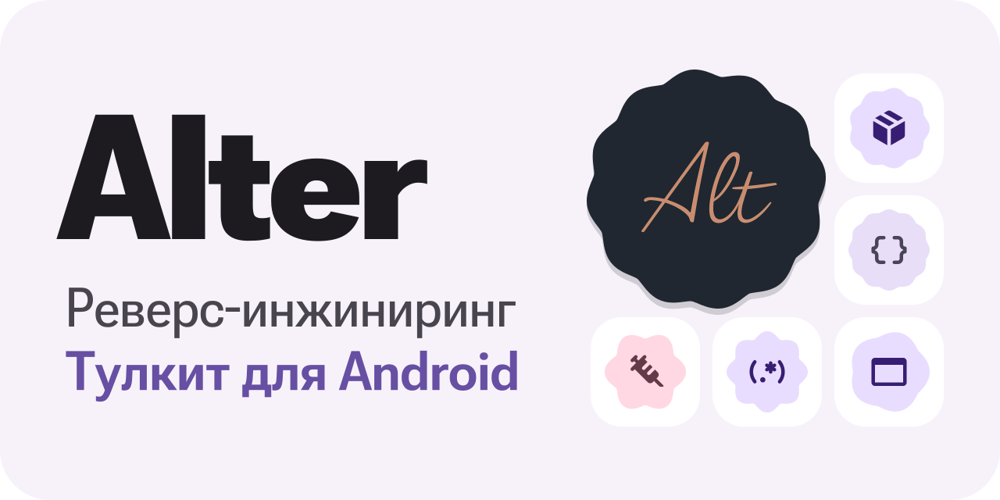
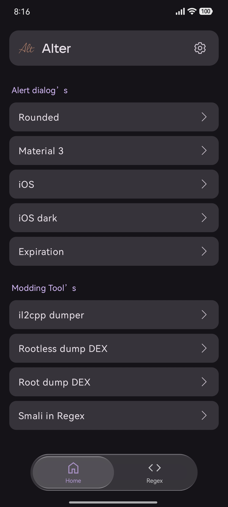
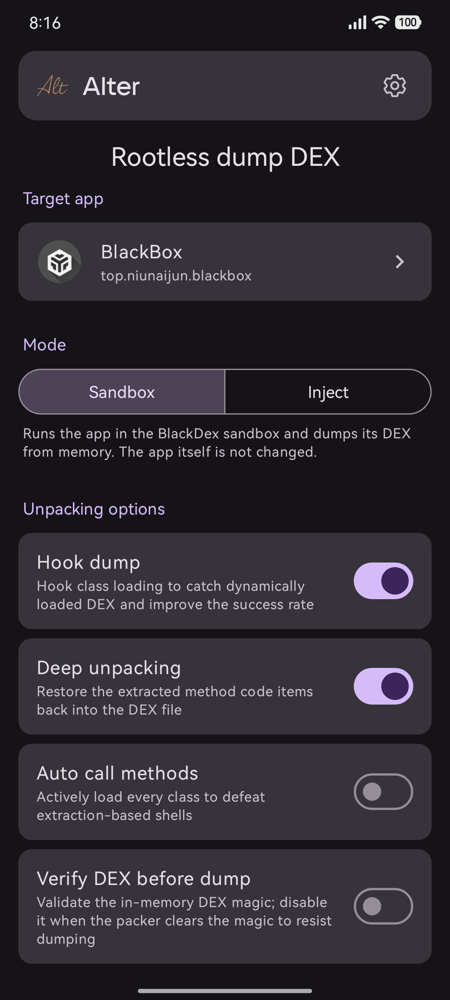
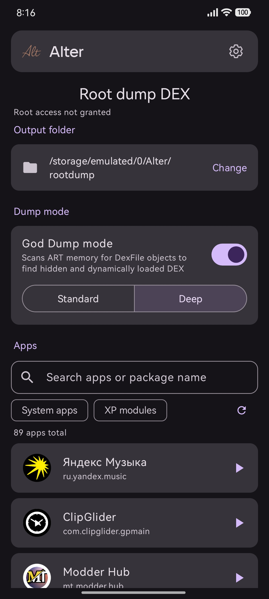
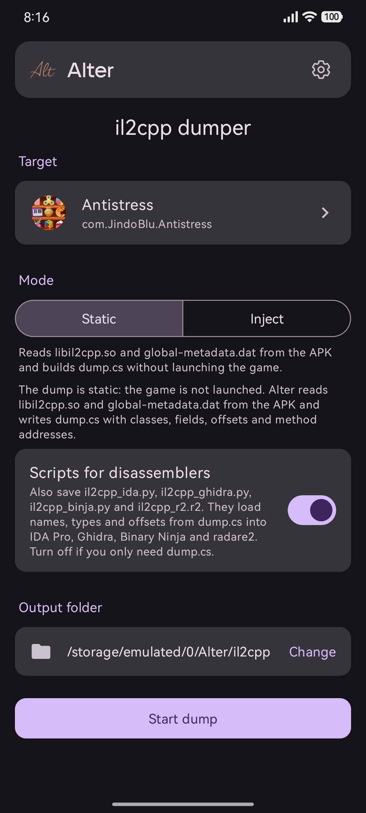
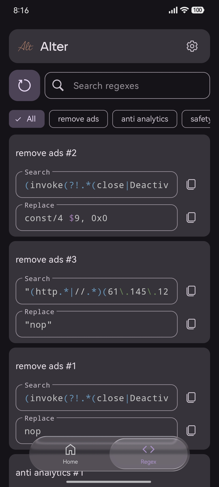
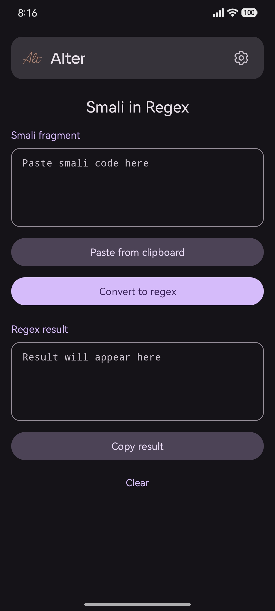

[English](README.md) · **Русский**

  <a href="https://github.com/vanth34/Alter/releases/latest"><picture><source media="(prefers-color-scheme: dark)" srcset="docs/assets/readme/banner-ru-dark.svg"></picture></a>

**Современный набор инструментов для модификации APK и реверс-инжиниринга**

Alter объединяет инструменты для работы с APK в одном приложении. Он создан для мододелов и реверс-инженеров, которым нужен удобный способ анализировать, патчить и изменять программы. Всё необходимое для работы в одном месте, без лишних инструментов и сложной настройки.

<picture><source media="(prefers-color-scheme: dark)" srcset="docs/assets/readme/badges/android-dark.svg"></picture> <picture><source media="(prefers-color-scheme: dark)" srcset="docs/assets/readme/badges/root-dark.svg"></picture> <picture><source media="(prefers-color-scheme: dark)" srcset="docs/assets/readme/badges/java-dark.svg"></picture> <a href="LICENSE"><picture><source media="(prefers-color-scheme: dark)" srcset="docs/assets/readme/badges/license-dark.svg"></picture></a>

 

<a href="https://github.com/vanth34/Alter/releases/latest/download/app-release.apk"><picture><source media="(prefers-color-scheme: dark)" srcset="docs/assets/readme/buttons/download-ru-dark.svg"></picture></a>&nbsp;&nbsp;<a href="https://t.me/AlterProject"><picture><source media="(prefers-color-scheme: dark)" srcset="docs/assets/readme/buttons/telegram-ru-dark.svg"></picture></a>

  
  
  
  
  
  

---

## <picture><source media="(prefers-color-scheme: dark)" srcset="docs/assets/readme/sections/start-dark.svg"></picture> Обзор

Alter, приложение «всё в одном» для реверс-инженеров и моддеров, объединяет задачи, которые обычно приходится решать в разных инструментах, а часто и на ПК: достать DEX из упакованного приложения, получить `dump.cs` из Unity-игры, держать под рукой библиотеку регулярных выражений с поиском и генерировать готовый Smali для alert-диалогов. Всё это в одном минималистичном интерфейсе на Material 3.

Работает на **Android 8.0+**, написано на **Java**. **Root не обязателен:** он нужен только для ROOT-дампа DEX.

> [!TIP]
> **Какой дампер выбрать?** Для обычного приложения начните с дампа DEX без root. Если приложение распознаёт песочницу, а root есть, используйте ROOT-дамп. Для Unity-игры берите дампер il2cpp. Если ничего не помогло, внедрите дампер в сам APK.

## <picture><source media="(prefers-color-scheme: dark)" srcset="docs/assets/readme/sections/features-dark.svg"></picture> Возможности

### <picture><source media="(prefers-color-scheme: dark)" srcset="docs/assets/readme/features/regex-dark.svg"></picture> Менеджер регулярок

Отдельное рабочее пространство для регулярных выражений, которыми вы пользуетесь при моддинге. Вместо разрозненных заметок Alter даёт организованную библиотеку с поиском, которую можно переносить между устройствами.

- **Добавляйте свои паттерны:** собирайте библиотеку так, как удобно вам. Alter это не фиксированный список, а место для паттернов, которые собираете и оттачиваете именно *вы*.
- **Папки:** распределяйте коллекцию по именованным папкам под задачи (удаление рекламы, анти-аналитика, safety, freemium и т. д.).
- **Подсветка синтаксиса:** группы, классы, квантификаторы и экранирование выделяются цветом, ошибки видны сразу.
- **Поиск, который не спешит:** поиск запускается по подтверждению запроса, поэтому список не перестраивается при каждом нажатии клавиши.
- **Бэкап и импорт:** экспортируйте всю коллекцию в `.zip` с `JSON`-файлами и восстанавливайте на любом устройстве. Импорт ничего не удаляет, а только добавляет новое.

> В отличие от инструментов, которые дают лишь пользоваться фиксированным набором заранее одобренных паттернов, Alter позволяет добавлять собственные регулярки, организовывать их и переносить куда угодно.

Подробнее: [docs/ru/features/regex-manager.md](docs/ru/features/regex-manager.md).

### <picture><source media="(prefers-color-scheme: dark)" srcset="docs/assets/readme/features/smali-regex-dark.svg"></picture> Smali в Regex

Вставьте фрагмент smali и получите готовую регулярку, которая найдёт его и после пересборки приложения: спецсимволы экранируются, регистры `v0`, `p1` превращаются в `[vp]\d+`, а метки `:cond_` и `:goto_` обобщаются.

Подробнее: [docs/ru/features/smali-to-regex.md](docs/ru/features/smali-to-regex.md).

### <picture><source media="(prefers-color-scheme: dark)" srcset="docs/assets/readme/features/dialogs-dark.svg"></picture> Генератор Alert-диалогов

Генерируйте готовый **Smali**-код alert-диалогов прямо из формы. Выберите стиль, заполните заголовок, текст, кнопки и ссылку, посмотрите превью и сохраните: Alter соберёт `classes.dex` и строку вызова, которую нужно вставить в свой проект.

- **Несколько стилей** из коробки, у каждого живое превью.
- Встроенная **защита от подделки**: сгенерированные диалоги проверяют собственное состояние, поэтому их нельзя незаметно обойти правкой `SharedPreferences` приложения.

Подробнее: [docs/ru/features/alert-dialogs.md](docs/ru/features/alert-dialogs.md).

### <picture><source media="(prefers-color-scheme: dark)" srcset="docs/assets/readme/features/dex-rootless-dark.svg"></picture> Дамп DEX без root

Извлекайте DEX из упакованных и защищённых приложений без root.

- **Песочница:** приложение запускается в песочнице BlackDex, а его DEX достаётся прямо из памяти. Исходное приложение не меняется.
- **Глубокий анпак:** возвращает извлечённые упаковщиком тела методов обратно в DEX, работает и на Android 12+.
- **Hook-дамп и автовызов** для упаковщиков, которые подгружают код позже.
- **32-битные цели** через отдельное приложение-помощник.

Подробнее: [docs/ru/features/dumpers.md](docs/ru/features/dumpers.md#дамп-dex-без-root).

### <picture><source media="(prefers-color-scheme: dark)" srcset="docs/assets/readme/features/dex-root-dark.svg"></picture> ROOT-дамп DEX

Если есть root, Alter перезапускает настоящее приложение и собирает все загруженные им DEX. Режим **God Dump** ищет объекты `DexFile` в памяти ART и восстанавливает скрытые DEX, которые обычный дамп не видит.

Подробнее: [docs/ru/features/dumpers.md](docs/ru/features/dumpers.md#root-дамп-dex).

### <picture><source media="(prefers-color-scheme: dark)" srcset="docs/assets/readme/features/il2cpp-dark.svg"></picture> Дампер il2cpp

Получайте `dump.cs` из Unity-игр с классами, полями, смещениями и адресами методов.

- **Статический режим:** читает `libil2cpp.so` и `global-metadata.dat` из установленной игры или файла `.apk`, `.apks`, `.xapk`, `.apkm`. Игру запускать не нужно.
- **Скрипты для дизассемблеров:** рядом с `dump.cs` сохраняются готовые скрипты для IDA Pro, Ghidra и других популярных дизассемблеров, чтобы имена и смещения сразу попали в ваш проект.

Подробнее: [docs/ru/features/dumpers.md](docs/ru/features/dumpers.md#дампер-il2cpp).

### <picture><source media="(prefers-color-scheme: dark)" srcset="docs/assets/readme/features/inject-dark.svg"></picture> Внедрение нативных дамперов

Если песочница или статический дамп не справились, внедрите дампер прямо в APK одним нажатием, без ручной правки `smali` и без сборочного окружения. Установите пропатченный APK, запустите, и приложение сдампит себя само.

- **il2cpp dumper:** дампит классы, методы и поля IL2CPP из запущенного Unity-приложения.
- **dex dumper:** извлекает DEX-файлы из памяти запущенного приложения.
- Сплиты сливаются в один APK, внутрь кладутся обе ARM-архитектуры.
- Повторная **подпись** пропатченного APK или сохранение оригинальной.

Подробнее: [docs/ru/features/dumpers.md](docs/ru/features/dumpers.md#внедрение-дамперов).

### <picture><source media="(prefers-color-scheme: dark)" srcset="docs/assets/readme/features/personalization-dark.svg"></picture> Оформление

- Material 3 и динамические цвета Monet, светлая и тёмная темы.
- Плавающая панель с эффектом Liquid Glass, качество которого подстраивается под устройство.
- Интерфейс переведён на многие языки.
- Встроенная проверка обновлений.

## <picture><source media="(prefers-color-scheme: dark)" srcset="docs/assets/readme/sections/install-dark.svg"></picture> Установка

**Требования:** Android 8.0 (API 26) или новее, процессор ARM. Root не нужен.

  <a href="https://github.com/vanth34/Alter/releases/latest/download/app-release.apk"><picture><source media="(prefers-color-scheme: dark)" srcset="docs/assets/readme/buttons/download-ru-dark.svg"></picture></a>

1. Нажмите **Скачать APK** выше: кнопка всегда отдаёт последнюю версию.
2. Откройте скачанный `app-release.apk`.
3. Разрешите установку из браузера или файлового менеджера, если Android спросит.

> [!TIP]
> У кнопки [постоянная ссылка](https://github.com/vanth34/Alter/releases/latest/download/app-release.apk): её можно сохранить в закладки или переслать, она всегда ведёт на свежую сборку. Все версии и списки изменений лежат на странице [**Releases**](https://github.com/vanth34/Alter/releases/latest).

Новые версии также выходят в Telegram-канале [t.me/AlterProject](https://t.me/AlterProject), а установленный Alter сам сообщит об обновлении.

Пошаговое руководство: [docs/ru/INSTALLATION.md](docs/ru/INSTALLATION.md).

## <picture><source media="(prefers-color-scheme: dark)" srcset="docs/assets/readme/sections/security-dark.svg"></picture> Разрешения

Alter запрашивает только то, что нужно для работы с APK-файлами, сохранения дампов и управления бэкапами регулярок. Каждое разрешение и причина его использования описаны в [docs/ru/PERMISSIONS.md](docs/ru/PERMISSIONS.md).

## <picture><source media="(prefers-color-scheme: dark)" srcset="docs/assets/readme/sections/credits-dark.svg"></picture> Используемые компоненты

Alter включает следующие open-source компоненты. Полные атрибуции и тексты лицензий доступны в [docs/ru/CREDITS.md](docs/ru/CREDITS.md) и [docs/ru/THIRD_PARTY_LICENSES.md](docs/ru/THIRD_PARTY_LICENSES.md).

- [**BlackDex**](https://github.com/CodingGay/BlackDex) · CodingGay · Apache-2.0
- [**Dobby**](https://github.com/jmpews/Dobby) · jmpews · Apache-2.0
- [**xHook**](https://github.com/iqiyi/xHook) · iQIYI · MIT
- [**FreeReflection**](https://github.com/tiann/FreeReflection) · tiann · MIT
- [**il2cppdumper**](https://github.com/muhammadrizwan87/il2cppdumper) · MuhammadRizwan · MIT
- [**dexdumper**](https://github.com/muhammadrizwan87/dexdumper) · MuhammadRizwan · MIT
- [**libsu**](https://github.com/topjohnwu/libsu) · topjohnwu · Apache-2.0
- [**ARSCLib**](https://github.com/REAndroid/ARSCLib) · REAndroid · Apache-2.0
- [**apksig**](https://android.googlesource.com/platform/tools/apksig) · AOSP · Apache-2.0
- [**smali**](https://github.com/google/smali) · Google · BSD-3-Clause
- [**liquidglass**](https://github.com/QWEA0/liquidglass) · pandadog · MIT

## <picture><source media="(prefers-color-scheme: dark)" srcset="docs/assets/readme/sections/license-dark.svg"></picture> Лицензия

Alter распространяется как **проприетарное ПО**, см. [LICENSE](LICENSE) (текст на английском как основной юридический язык).

Файлы, **сгенерированные** в Alter, покрываются отдельной разрешительной [лицензией на генерируемый контент](LICENSE-GENERATED-CONTENT.txt): их можно свободно использовать в личных и коммерческих проектах, а указание авторства требуется при распространении сгенерированного контента в составе библиотеки или пака шаблонов.

Встроенные сторонние компоненты остаются под своими лицензиями.

## Ссылки

- **Канал проекта:** [t.me/AlterProject](https://t.me/AlterProject)
- **Разработчик:** RevEx ([t.me/revexlab](https://t.me/revexlab))

## Отказ от ответственности

Alter предназначен для исследований безопасности, обучения и модификации приложений, которыми вы владеете или которые вправе изменять. Вы несёте полную ответственность за использование инструмента и за соблюдение применимых законов и условий использования третьих сторон. Подробности и порядок обращений в [SECURITY.ru.md](SECURITY.ru.md).

 
© 2026 Alter · Разработано RevEx

